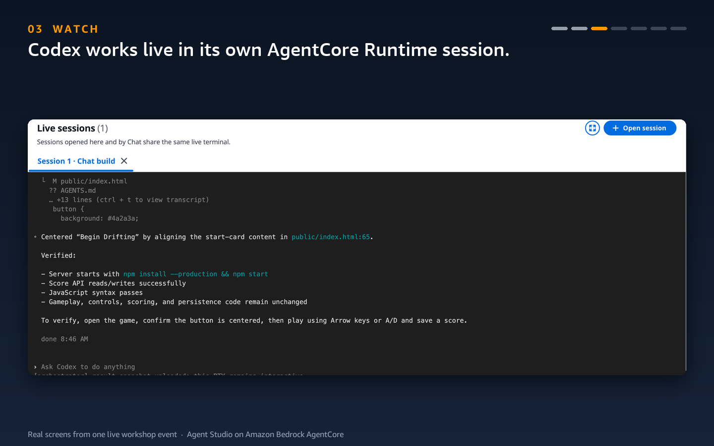
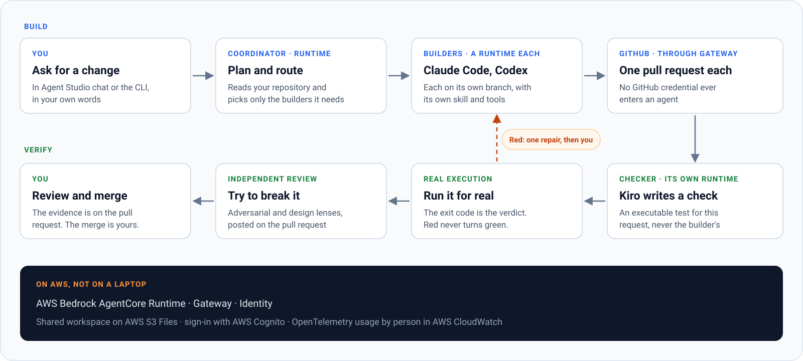
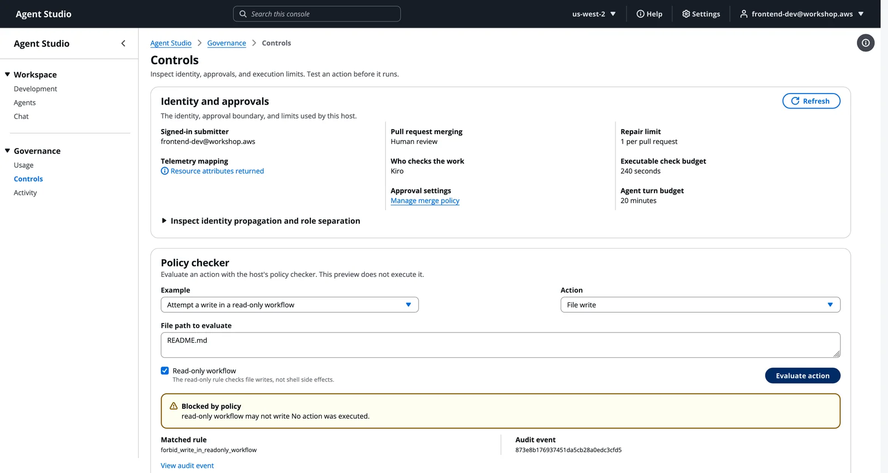
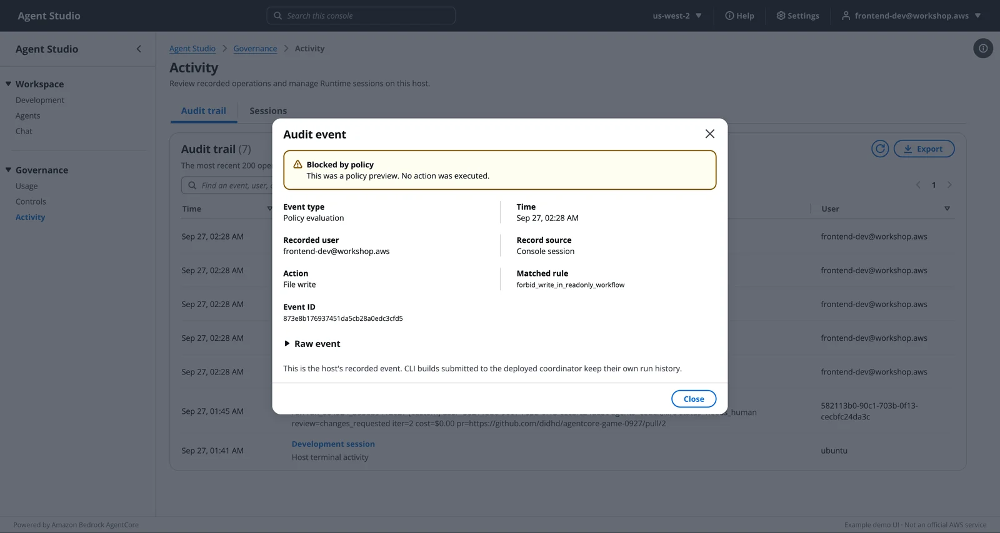
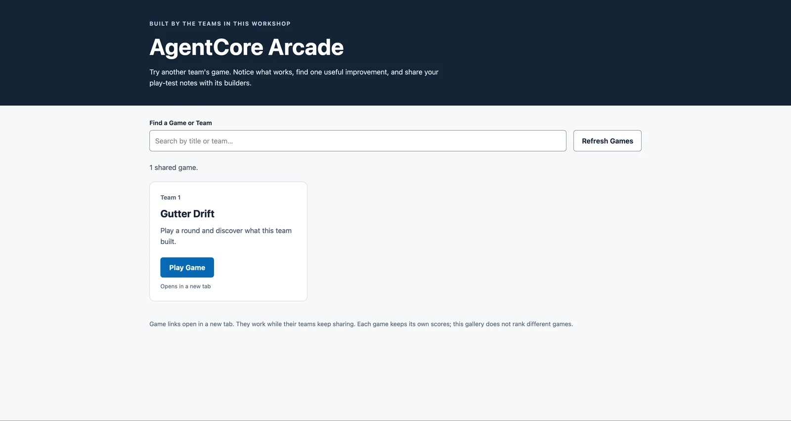

<div align="center">

# Coding Agents on Amazon Bedrock AgentCore

**Your coding agent, without your laptop's limits.**

It keeps working when you close the lid, it runs twenty at once,<br>
and it wakes up on its own when your repository changes.

[Get started](#get-started) · [The three parts](#the-three-parts) · [Go further](#go-further-a-team-that-checks-its-own-work) · [Operator notes](docs/operators.md)

<sub>The code behind the AWS re:Invent 2026 workshop <b>AIM416: Scale your coding agents beyond the laptop with AgentCore</b></sub>

</div>

## Why this exists

Claude Code, Codex, and Kiro feel best in your own terminal, and that terminal is
the limit. The agent stops when the laptop sleeps, runs one task at a time, and
waits for you to type. Amazon Bedrock AgentCore Runtime gives every session its own
microVM, so the same agent can outlive the laptop, run in parallel, and start from
an event. This repository is a complete, working example, from one container image.

## The three parts

**1. Close the lid.** One command deploys Claude Code to AgentCore Runtime; one
more opens a terminal inside a new session, a microVM of its own. Give it a task,
press **Ctrl+]**, close the laptop, and come back to the same conversation with
the work done. Files live on an S3 Files mount, so they outlive the session.

```bash
cd coding-agents
./deploy-prebuilt.sh claude-code   # one Runtime from the prebuilt image
./connect.sh                       # a new session; Ctrl+] detaches, ./connect.sh --resume returns
```

**2. Twenty at once.** One command sends the same job to one agent per
repository. Each agent is a new session, so each is an isolated microVM; a live
board shows them work, and the host checks every change by calling it.

```bash
python3 fanout.py --agents 20
```

**3. It wakes up.** Connect a GitHub repository and open a pull request. GitHub's
event reaches an endpoint in your stack, which starts a new session that reviews
the diff and posts the review on the pull request. The agent never holds a
GitHub token: comments go through AgentCore Gateway.

```bash
./connect-github.sh owner/repository   # two clicks on GitHub: Create, Install
```

The reviewer is one file, [`coding-agents/pr_review/handler.py`](coding-agents/pr_review/handler.py);
its prompt is where your team's checklist goes.

## Go further: a team that checks its own work

The same Runtime pattern serves Codex and Kiro, and a coordinator turns them into
a team. You ask for a change and get back a pull request that a separate agent
tested and an independent review read. Then you decide whether to merge.

<p align="center">
  <picture>
    <source media="(prefers-reduced-motion: reduce)" srcset="docs/assets/demo-poster.png">
    <source type="image/webp" srcset="docs/assets/demo.webp">
    
  </picture>
</p>
<p align="center"><sub>Real screens from one live workshop event, in loop order. Nothing is mocked.</sub></p>

**Discover → Plan → Execute → Verify → Iterate.** A loop is only as good as its
verify step, so every choice here protects it.

- **The maker is never the checker.** Builders write code. A different agent, in its
  own Runtime with its own instructions, decides whether it works.
- **Verification is real execution.** The checker writes an executable test for
  *your* request. The engine runs it and reads the exit code. A red check never
  turns green, and no result is ever faked.
- **Bounded, then a human.** A failed check goes back to the builder that owns it
  once, on the same pull request. Then the loop stops and hands you the evidence.
- **Skills, not scripts.** Agents read principle-based skills and choose their own
  files, language, and structure. Nothing in this repository encodes the answer.

<p align="center"></p>

## Agent Studio

A browser console for the whole loop, included in [`console/`](console). The core
workshop uses the terminal; the Agent Studio track brings the same work into a
browser, with usage and controls per person.

| Workspace | Governance |
|---|---|
| **Chat** · ask, plan, and follow each build to its pull request | **Usage** · token usage by agent and by person, from CloudWatch |
| **Agents** · open a live terminal in any agent's Runtime session, or watch the one Chat started | **Controls** · identity, role boundaries, merge policy, and a policy checker |
| **Development** · edit files and run commands on the workshop host | **Activity** · an audit trail of decisions, and every Runtime session |

<details>
<summary><b>See more screens</b></summary>
<br>

**Development.** The workshop host in your browser: files, editor, and a terminal.


**Controls.** Who is signed in, who checks the work, the merge and repair limits, and a policy check that blocked a write without running it.



**Activity.** The audit record for that decision: who, which rule, and that nothing was executed.



**Event gallery.** Teams publish what their agents built so the room can play it.



</details>

## Get started

**At AWS re:Invent 2026 (AIM416) or another AWS event:** your account, a
browser-based VS Code, and this repository are ready. Open the workshop and start
with Get in.

**In your own AWS account:** launch the workshop stack in one region, then follow
the same pages. You need Amazon Bedrock access to Claude Sonnet 5, and a GitHub account
for part 3.

<p>
  <a href="https://us-west-2.console.aws.amazon.com/cloudformation/home?region=us-west-2#/stacks/create/review?templateURL=https://ws-assets-prod-iad-r-pdx-f3b3f9f1a7d6a3d0.s3.us-west-2.amazonaws.com/7b1cc169-b7a2-4a64-b215-df050bd8c8f1/cfn.yaml&stackName=coding-agents-workshop&param_AssetsBucketName=ws-assets-prod-iad-r-pdx-f3b3f9f1a7d6a3d0&param_AssetsBucketPrefix=7b1cc169-b7a2-4a64-b215-df050bd8c8f1"></a>&nbsp; US West (Oregon), recommended<br>
  <a href="https://us-east-1.console.aws.amazon.com/cloudformation/home?region=us-east-1#/stacks/create/review?templateURL=https://ws-assets-prod-iad-r-iad-ed304a55c2ca1aee.s3.us-east-1.amazonaws.com/7b1cc169-b7a2-4a64-b215-df050bd8c8f1/cfn.yaml&stackName=coding-agents-workshop&param_AssetsBucketName=ws-assets-prod-iad-r-iad-ed304a55c2ca1aee&param_AssetsBucketPrefix=7b1cc169-b7a2-4a64-b215-df050bd8c8f1"></a>&nbsp; US East (N. Virginia)
</p>

| Part | You do | You learn |
|---|---|---|
| **1. Close the lid** | Deploy Claude Code, give it a task, detach, come back | A session is a microVM in the cloud, so it outlives your laptop |
| **2. Twenty at once** | Send one job to twenty agents with one command | More sessions are more microVMs, so parallel is a loop, not a fleet |
| **3. It wakes up** | Connect a repository and open a pull request | An event can start a session, so the agent works without you |

Lost at any point? One read-only command says where you are and what to run next:

```bash
python3 orchestrator/progress.py
```

When you finish, `./connect.sh --stop` ends your session. In your own account,
follow the workshop's cleanup steps: the host, Runtimes, Gateway, and NAT gateway
are billed while they exist.

## What's in the repository

| Folder | What it holds |
|---|---|
| [`coding-agents/`](coding-agents) | One folder per agent (container, steering, deploy), `connect.sh`, `fanout.py`, the pull request reviewer, and the GitHub Gateway |
| [`orchestrator/`](orchestrator) | The loop: routing, dispatch, checks, review, GitHub, and saved run records |
| [`orchestrator-agent/`](orchestrator-agent) | The coordinator, packaged for AgentCore Runtime |
| [`console/`](console) | Agent Studio (React and FastAPI) |
| [`harness-skills/`](harness-skills) | The skills each agent reads |
| [`interactive-api/`](interactive-api), [`metrics-api/`](metrics-api) | Terminal sessions and usage queries behind the console |
| [`e2e/`](e2e) | Journey and integration tests |

Pins, tests, troubleshooting, and hard-won gotchas are in
[docs/operators.md](docs/operators.md).

## Security

This is sample code for learning. Agent Studio is an example UI, not an AWS
service. Review IAM scope, networking, and data handling before using any of it
in production. To report a security issue, use
[AWS vulnerability reporting](https://aws.amazon.com/security/vulnerability-reporting/)
rather than a public issue. See [CONTRIBUTING](CONTRIBUTING.md).

## License

MIT-0. See [LICENSE](LICENSE).
